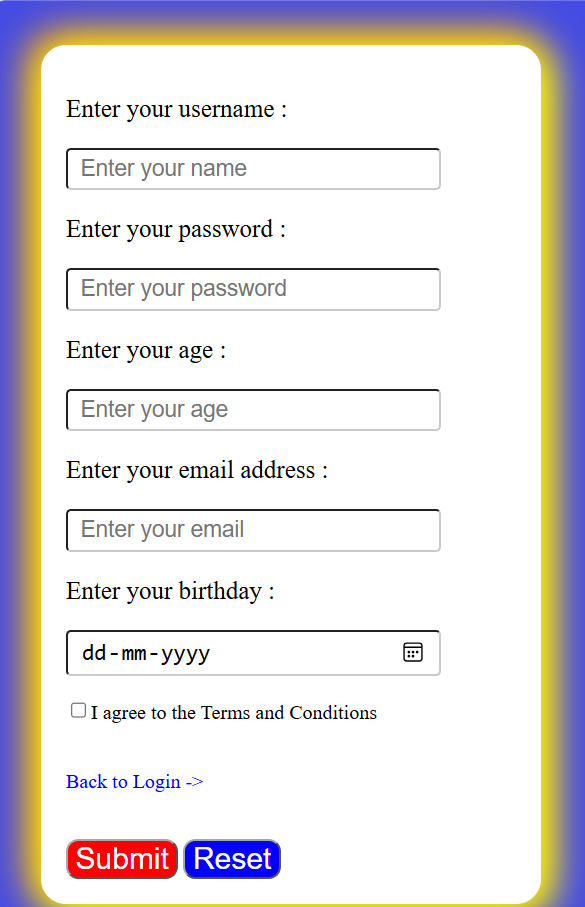
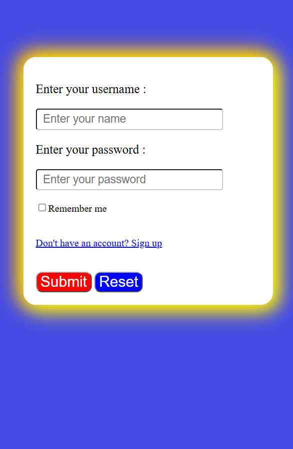

# Login and Signup Form Using HTML & CSS





## 📌 Project Overview

This project is a simple and beginner-friendly **Login and Signup Form** developed using HTML and CSS. It contains two separate webpages: a login page for existing users and a signup page for new users.

The project demonstrates the fundamentals of front-end web development, including form creation, input validation, CSS styling, layout design, and navigation between webpages.

## ✨ Features

### 📝 Signup Form
- Username input field.
- Password input field with hidden characters.
- Age input with a minimum age requirement of 18 years.
- Email input with basic browser validation.
- Birthday selection using a date picker.
- Terms and Conditions checkbox.
- Submit and Reset buttons.
- Link to navigate to the login page.

### 🔐 Login Form
- Username input field.
- Password input field.
- Remember Me checkbox.
- Submit and Reset buttons.
- Link to navigate to the signup page.

### 🎨 Styling and Design
- Blue background for both webpages.
- White form container with rounded corners.
- Yellow and orange box-shadow effects.
- Consistent input field styling.
- Focus effects on input fields.
- Custom colors for Submit and Reset buttons.
- Centered form layout using CSS Flexbox.

## 🛠️ Technologies Used

- **HTML5** — To create the structure of the login and signup forms.
- **CSS3** — To style the forms, manage spacing, apply colors, create shadows, and control the layout.

No JavaScript or external libraries are used in this project.

## 📂 Project Structure

```text
Login-Signup-Form/
│
├── login.html
├── signup.html
└── README.md
```

## 🚀 How to Run the Project

1. Clone or download this repository.
2. Open the project folder.
3. Open `signup.html` or `login.html` in your web browser.
4. Use the links on each page to navigate between the login and signup forms.
5. Try entering different values to test the built-in HTML form validation.

No additional installation or setup is required.

## 📚 HTML Concepts Practised

- Basic HTML document structure.
- Form elements using the `<form>` tag.
- Input types such as `text`, `password`, `number`, `email`, and `date`.
- The `required` attribute for mandatory fields.
- The `min` attribute for minimum age validation.
- Labels, links, checkboxes, and buttons.
- The `name` and `id` attributes.
- Navigation between multiple HTML pages.

## 🎨 CSS Concepts Practised

- Universal selector (`*`).
- Element, class, and ID selectors.
- Background colors and text styling.
- Padding and the box model.
- Rounded corners using `border-radius`.
- Box shadows.
- Flexbox alignment.
- Input styling and focus states using `:focus`.
- Cursor styling for interactive elements.

## ⚠️ Limitations

This project is a **front-end demonstration only**.

- User registration details are not stored in a database.
- Login credentials are not authenticated.
- The Submit buttons do not perform actual account creation or login without a backend.
- The Remember Me checkbox is only a visual form control.
- The `POST` form method alone does not process or securely store user information.

A backend and appropriate authentication mechanisms would be required to implement a functional login and signup system.

## 🎯 Learning Objectives

The main objective of this project is to practise fundamental HTML and CSS concepts by building a practical webpage. It helps develop an understanding of form elements, browser-based input validation, CSS styling, layout management, and navigation between pages.

## 🔮 Future Improvements

- Add responsive styling for mobile devices.
- Improve form accessibility using properly associated labels.
- Add JavaScript-based interactive validation.
- Create a backend for registration and login.
- Connect the application to a database.
- Add password visibility controls and user feedback messages.
- Improve the overall UI with transitions and animations.

## 👨‍💻 Author

Created as a beginner front-end web development practice project using HTML and CSS.

## 📄 License

This project is available for learning and educational purposes. You may modify it and use it as a reference for your own practice projects.
